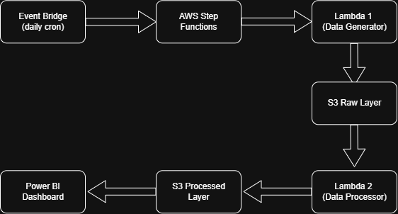
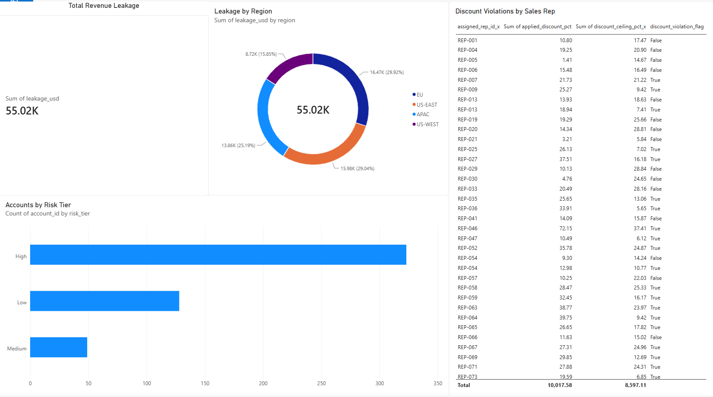

# Oracle Cloud Revenue Leakage Detection Pipeline

An end-to-end data engineering pipeline that automatically detects revenue leakage in Oracle cloud contracts using AWS, Python, and Machine Learning. Infrastructure is defined in Terraform and deployed automatically with GitHub Actions.

> **Data note:** All data in this project is **synthetic**, generated with Python Faker, because real Oracle customer data is not accessible. Leakage cases (overuse, underbilling, discount violations) are injected by the generator, so results show that the pipeline works end to end, not how the models would perform on real data. The pipeline is designed to be adapted to real OCI usage data.

## Business Problem
Large cloud vendors like Oracle lose money to three types of leakage:
- **Overuse**: customers consuming more cloud resources than their contract allows
- **Underbilling**: invoices sent below actual usage cost
- **Discount violations**: sales reps applying discounts beyond their authorized ceiling

## Solution
An automated pipeline that generates synthetic contract, usage, and billing data daily, joins the three datasets, flags leakage with rules and ML models, and writes results to S3 for reporting in Power BI.

## Results

### Initial run (local, 500 synthetic accounts)
Computed from the CSVs written by `generate_data.py`; reproduce with `python analyze_local.py`:

| Metric | Value |
|---|---|
| Overuse leakage (74 accounts) | $55,023.55 |
| Underbilling leakage (70 accounts) | $37,241.09 |
| **Total leakage (overuse + underbilling)** | **about $92.3K** |
| Discount violations | 295 |
| Accounts with at least one leakage flag | 348 |

The Power BI dashboard below was built from this dataset (its $55.02K is the overuse figure).

### Deployed pipeline (AWS, one daily run)
The Lambda pipeline generates a fresh random dataset each day, so totals vary. An example run:

| Metric | Value |
|---|---|
| Underbilled accounts / unbilled usage | 83 / $39,532.36 |
| Discount violations | 273 |
| Overuse accounts | 95 |
| Isolation Forest precision / recall | 1.00 / 0.21 |
| Logistic Regression precision / recall (30% held-out split) | 1.00 / 1.00 |

Typical daily range: about $35K to $40K unbilled and 270 to 290 violations.

**How to read the model results**
- Logistic Regression scores perfectly because the generator makes underbilled accounts separable by bill ratio. It shows the model recovers injected labels, not real-world accuracy.
- Isolation Forest flags 75 accounts (set by `contamination=0.15`) and catches about 21% of leaky accounts. Its precision is high partly because more than half of accounts have some form of leakage, so recall is the more informative number.

## Architecture


```
EventBridge (daily, midnight UTC)
        |
        v
Step Functions
   1. Generator Lambda -> S3  raw/{contracts,usage,billing}/date=YYYY-MM-DD/
   2. Processor Lambda -> S3  processed/date=YYYY-MM-DD/{flagged_accounts.csv, summary.json}
```

## Tech Stack
| Layer | Technology |
|-------|-----------|
| Data | Python Faker (synthetic data) |
| Ingestion | AWS Lambda, Python |
| Storage | AWS S3 (Hive-style `date=` partitions) |
| Orchestration | AWS Step Functions, EventBridge |
| Infrastructure | Terraform (IaC, remote state in S3) |
| CI/CD | GitHub Actions |
| Processing | Python, numpy (Lambda layer) |
| ML Models | Isolation Forest, Logistic Regression (scikit-learn) |
| Testing | PyTest (5 unit tests) |
| Visualization | Power BI |

## Synthetic Data
The generator (`lambda/generator/lambda_function.py`, also `generate_data.py` locally) creates 500 fake accounts per run with Faker:
- **Contracts:** account, company, contracted compute and storage, discount ceiling, region, sales rep
- **Usage:** about 15% of accounts are given usage above their contract (overuse)
- **Billing:** about 15% of accounts are billed below expected (underbilling), and discounts are random from 0 to 40% (violations when above the contract ceiling)

## ML Models
**Isolation Forest** (unsupervised): detects anomalous accounts without labeled data

**Logistic Regression** (supervised): predicts underbilled accounts, scored on a 30% held-out split

## Infrastructure as Code (Terraform)
All AWS resources are provisioned with Terraform (`terraform/main.tf`):
- S3 bucket with partitioned folder structure
- 2 Lambda functions (generator and processor), zipped by Terraform from `lambda/`
- Lambda layer with numpy, scipy, and scikit-learn
- IAM roles and policies
- Step Functions state machine
- EventBridge daily schedule
- Remote state stored in S3 (`terraform/backend.tf`) with S3-native locking, so local and CI runs share the same state

## CI/CD (GitHub Actions)
The workflow in `.github/workflows/terraform.yml` runs on every push to `main`:
1. Installs dependencies and runs **PyTest** (a failing test stops the run before anything is deployed)
2. Bundles the Lambda dependencies and builds the scikit-learn layer
3. Runs `terraform fmt -check`, `init`, and `validate`
4. Runs `terraform plan`
5. Runs `terraform apply`, so infrastructure and Lambda code changes are deployed without manual steps

On pull requests, the workflow runs the checks and `plan` but does not apply. AWS credentials are stored as GitHub Actions secrets.

## Project Structure
```
oracle-revenue-pipeline/
├── .github/workflows/terraform.yml   # CI/CD pipeline
├── terraform/
│   ├── main.tf                       # Infrastructure as Code
│   └── backend.tf                    # Remote state (S3)
├── lambda/
│   ├── generator/                    # Synthetic data Lambda
│   └── processor/                    # Detection Lambda
├── layer_requirements.txt            # scikit-learn layer dependencies
├── requirements.txt                  # Local and CI dependencies
├── generate_data.py                  # Local synthetic data script
├── generate_contracts.py             # Local contract generator
├── analyze_local.py                  # Reproduces the initial-run figures from the CSVs
├── test_pipeline.py                  # PyTest unit tests
└── README.md
```

## S3 Data Lake Structure
```
s3://oracle-revenue-pipeline-tf/
├── raw/
│   ├── contracts/date=YYYY-MM-DD/contracts.csv
│   ├── usage/date=YYYY-MM-DD/usage.csv
│   └── billing/date=YYYY-MM-DD/billing.csv
└── processed/
    └── date=YYYY-MM-DD/
        ├── flagged_accounts.csv
        └── summary.json
```

## Quick Start

1. Clone the repository:
```bash
git clone https://github.com/anne834/oracle-revenue-pipeline.git
cd oracle-revenue-pipeline
```

2. Install dependencies:
```bash
pip install -r requirements.txt
```

3. Run the PyTest unit test suite:
```bash
pytest test_pipeline.py -v
```

4. Build the Lambda dependencies (not committed, so build them before Terraform):
```bash
pip install -r lambda/generator/requirements.txt -t lambda/generator/vendor --no-compile
pip install -r layer_requirements.txt -t layer/python --platform manylinux_2_28_x86_64 --platform manylinux2014_x86_64 --only-binary=:all: --python-version 3.12 --implementation cp --no-compile
```

5. Deploy cloud infrastructure via Terraform (needs AWS credentials and your own state bucket in `terraform/backend.tf`):
```bash
cd terraform
terraform init
terraform apply
```

## Dashboard Insights

The Power BI dashboard was built from the initial local synthetic dataset (see Results) and shows the reporting layer for the pipeline's output. Risk tiers come from that earlier version; the deployed processor does not assign them yet. It provides four views for a Revenue Operations team:

**1. Total Revenue Leakage (KPI Card)**
Shows $55K in overuse leakage detected across all accounts, the headline number a revenue operations manager sees first.

**2. Accounts by Risk Tier (Bar Chart)**
- 323 accounts scored as **High risk**
- 128 accounts scored as **Low risk**
- 49 accounts scored as **Medium risk**

This helps the team prioritize which accounts to investigate first.

**3. Leakage by Region (Donut Chart)**
- EU: $16.47K (29.9%)
- US-EAST: $15.98K (29%)
- APAC: $13.86K (25.2%)
- US-WEST: $8.72K (15.8%)

**4. Discount Violations by Sales Rep (Table)**
Lists reps who applied a discount beyond their authorized ceiling, for example REP-088 at 72.92% against a 30.07% ceiling and REP-046 at 72.15% against a 37.41% ceiling.

